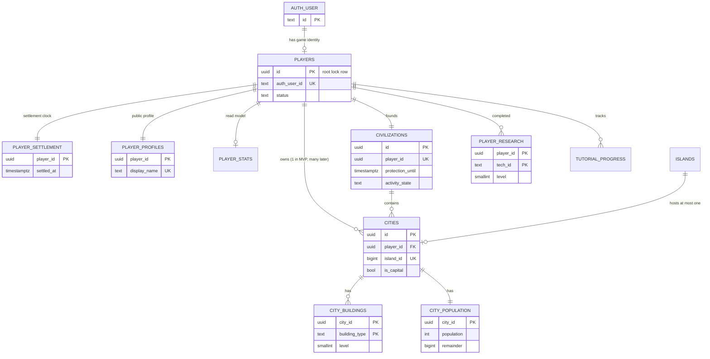
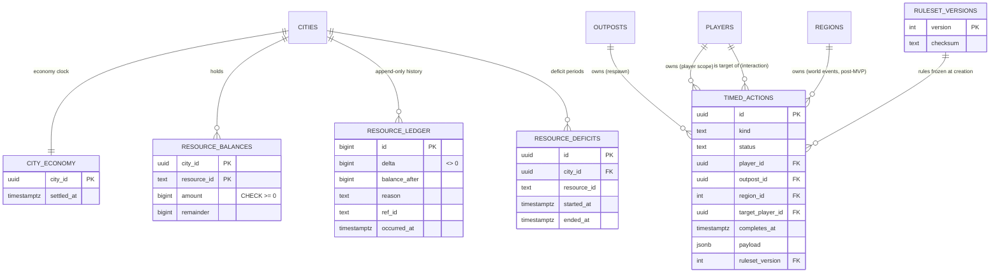
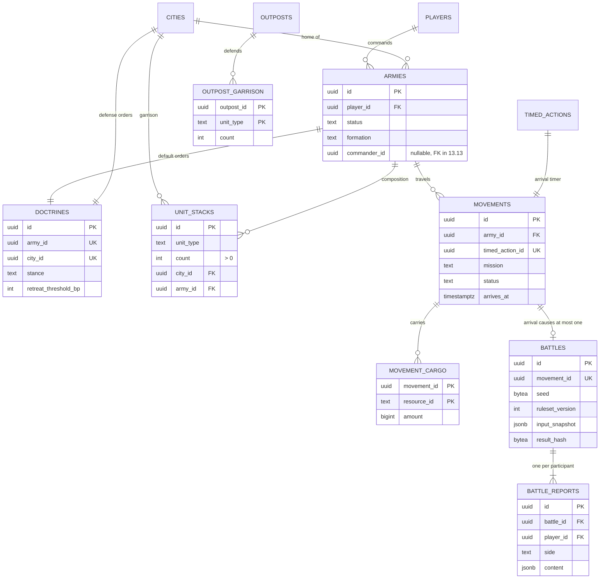
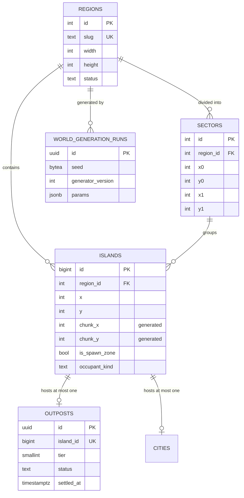
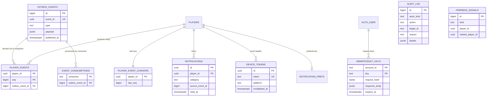

# DATABASE_DESIGN — Chronos Cradle: Temporal Empires

| Field | Value |
|---|---|
| Status | Draft for the S01 gate (Part 1.3) |
| Last updated | 2026-10-31 |
| Depends on | `SYSTEM_ARCHITECTURE.md` (1.2), ADR-0006 (PostgreSQL 18 + Drizzle + `pg`), ADR-0007 (Better Auth), ADR-0011 |
| Executable reference | [`database/mvp-reference-schema.sql`](database/mvp-reference-schema.sql) · [`database/mvp-reference-checks.sql`](database/mvp-reference-checks.sql) |

**How to read this document.** §2 sets conventions. §3 shows the ERDs. §4 explains each table: purpose, owner, key columns, constraints, indexes and why. §5 is the **concurrency strategy and lock order**. §6 is the migration policy. §7 covers map indexing and world partitioning. §9 shows how every post-MVP feature attaches without rewriting MVP tables. §10 maps every MVP Part to its tables.

**Verification done in this Part.** The reference schema was applied to **PostgreSQL 18.6** (Docker `postgres:18`). It creates 39 tables in schemas `game` and `platform`. The checks script ran 26 checks, all passing:
- 22 constraint checks, e.g. no negative balances, units in exactly one place, one battle per arrival, append-only ledger, battles and audit log;
- 2 index-usage checks: the viewport query on 20,000 islands and the reconciler query on 50,000 history rows;
- 2 behaviour checks: many cities per player allowed, account deletion order.

A two-session test confirmed the root-lock spending pattern of §5: the second request waits, then sees the updated balance and is rejected.

> The reference SQL is a **design artifact**. Each Part creates its own tables through Drizzle in `packages/db` (2.3 onward); from then on the Drizzle schema and committed migrations are authoritative, and this document is updated in the same change.

---

## 1. Design goals

1. **PostgreSQL alone can reconstruct the universe** (rule 4). Redis and job state are derivable.
2. **Invariants live in the database where they can** (CHECK, UNIQUE, partial unique, FK, append-only triggers). Application checks come first; the database is the last line of defence.
3. **Integers only** for economy and combat (`bigint` amounts, basis points for percentages, fixed-point remainders). No `numeric`, `real` or `double precision` in authoritative state (rule 8).
4. **One clear owner per table** (verified again in Part 1.5).
5. **Additive evolution**: every post-MVP feature attaches through new tables or nullable columns, never by rewriting an MVP table (§9).

---

## 2. Conventions

| Topic | Rule | Why |
|---|---|---|
| Schemas | `auth` (Better Auth, managed by its CLI + drizzle-kit), `game` (domain state), `platform` (outbox, idempotency, audit, signals) | separates third-party, gameplay and infrastructure data; one database |
| Primary keys | `uuid` with **UUIDv7** default (`uuidv7()`, native in PostgreSQL 18; the app may supply its own v7) for entities. `bigint identity` for high-volume append-only rows (ledger, outbox, audit) and generated world cells (islands). `int identity` for regions/sectors | v7 is time-ordered (good index locality), not enumerable like a counter, and can be generated before insert (needed for outbox payloads). Identity is compact for huge tables |
| Deterministic ordering | ties are broken by `id` (UUIDv7 compares by time, then randomness); the settlement order is `(completes_at, id)` | same order on every replay |
| Time | `timestamptz`, always UTC. **Game-time columns** (`starts_at`, `completes_at`, `occurred_at`, `settled_at`, `founded_at`) are **always written explicitly from the injected `Clock`**. `default now()` is allowed only on metadata (`created_at`, `recorded_at`) | rule 5; a DB default would bypass the fake clock in tests |
| Resource amounts | `bigint` whole units + `remainder bigint` for the sub-unit fixed-point carry (scale defined in `GAME_SIMULATION_SPEC.md`, Part 1.4). Mapped to TypeScript `bigint`; strings on the wire | no precision loss; path-independent accrual |
| Percentages | integer **basis points** (`_bp`, 10000 = 100%) | integers only |
| Game-data identifiers | `text` checked by format regex (`^[a-z][a-z0-9_]{1,39}$`), validated against `game-data` in the application | adding a building/unit/tech is a data change, not a schema migration (rule 12) |
| Closed enumerations | `text` + `CHECK (x in (...))` only for **structural** states the code branches on (status columns, sides, platforms). Game-content enumerations (stances, outcomes, categories) use the format regex | a structural state change needs a code change anyway; content stays data-driven |
| Polymorphic links | separate nullable FK columns + `CHECK (num_nonnulls(...) = 1)`, never `(kind, id)` pairs without FKs | real foreign keys |
| JSONB | only for (a) per-kind payloads validated by Zod (`timed_actions.payload`), (b) immutable snapshots (`battles.input_snapshot`, `result`, report content), (c) generator params. **Never** for data that is queried, joined or constrained | keeps invariants enforceable |
| Append-only tables | `resource_ledger`, `battles`, `audit_log`: `BEFORE UPDATE OR DELETE` trigger raises `42501` | history cannot be rewritten by a bug |
| Deletion | game entities are never hard-deleted in normal play. Status/`ended_at` columns are used instead. Account deletion anonymises the player and keeps history (§4.2) | battle history and ledgers stay consistent; GDPR erasure is handled by anonymisation (12.6) |
| Naming | `snake_case`, plural table names, `_id` FKs, `_at` timestamps, `_bp` basis points, `_uq` / `_idx` index suffixes | boring and searchable |

---

## 3. Entity-relationship diagrams (MVP)

The ERDs are split by area for readability. Attributes shown are the key ones; the full column list is in §4 and the reference SQL.

### 3.1 Identity, civilization, city, progression



### 3.2 Economy and timed actions



### 3.3 Military and combat



### 3.4 World



### 3.5 Platform: events, notifications, idempotency, audit



---

## 4. Table catalogue

Owner = the domain that owns the table (SYSTEM_ARCHITECTURE §5; final check in 1.5). "Lock" says whether the table is protected by the **player root lock** (§5).

### 4.1 Simulation core
| Table | Owner | Purpose & key columns | Constraints | Indexes (why) | Lock |
|---|---|---|---|---|---|
| `ruleset_versions` | Simulation core | Registry of `game-data` bundles: `version int`, `checksum`, `activated_at`. Every timed action and battle references the version it was created under | `version > 0` | PK | — |
| `timed_actions` | Simulation core (payload per `kind` defined by its domain) | "Something that finishes at a time." `kind`, `status` (`scheduled`/`completed`/`cancelled`), **owner** = exactly one of `player_id` / `outpost_id` / `region_id`, optional `city_id` scope, optional **counterparty** `target_player_id` / `target_outpost_id` (makes it an *interaction*, SYSTEM_ARCHITECTURE §4.3; `is_interaction` is a generated column), `starts_at`, `completes_at`, `completed_at`, `cancelled_at`, `payload jsonb` (Zod per kind), `ruleset_version`, `version` | exactly one owner; at most one counterparty; `completes_at >= starts_at`; status ⇔ timestamp consistency; **partial unique**: one scheduled upgrade per `(city, building_type)` | `(completes_at) WHERE scheduled` → reconciler sweep. `(player_id, completes_at, id) WHERE scheduled` → local settlement in order. `(target_player_id, completes_at, id) WHERE scheduled` → "interactions involving me" (I-SETTLE). Same two for outposts. All partial, so they stay small however much history accumulates (verified with 50k completed rows) | yes (owner's root) |
| `player_settlement` | Simulation core | `settled_at`: the player's settlement watermark. Monotonic: effective settle time = `max(requested t, settled_at)`, which absorbs small clock skew between API instances | — | PK | yes |

### 4.2 Players, civilizations, cities
| Table | Owner | Purpose & key columns | Constraints | Indexes (why) | Lock |
|---|---|---|---|---|---|
| `players` | Player profiles | **The root lock row of all player-owned game state.** `auth_user_id` (nullable only after deletion), `status` (`active`/`suspended`/`dormant`/`deleted`), `last_active_at`, `deleted_at` | `deleted ⇔ deleted_at`; `auth_user_id` may be NULL **only** when `status = 'deleted'`, which forces the correct deletion order (anonymise, then delete the auth user; the FK uses `ON DELETE SET NULL`) | `auth_user_id` UNIQUE (one player per account; also makes double "found civilization" requests collide) | is the root |
| `player_profiles` | Player profiles | Public face: `display_name`, avatar/banner keys, `show_stats` | length 3–24 | UNIQUE `lower(display_name)`: case-insensitive uniqueness under concurrency (6.1 test) | no (profile edits are not game state) |
| `player_stats` | Player profiles | Read model fed by events: battles won/lost, outposts cleared | counters ≥ 0 | PK | no (leaf; updated via `event_consumptions` dedupe) |
| `civilizations` | Civilizations | In-world identity and status: `name`, `founded_at`, **`protection_until`** + `protection_ended_reason` (7.4), **`activity_state`** (`active`/`inactive`/`dormant`, 11.4) | name 3–32 | `player_id` UNIQUE (one civilization per player); UNIQUE `lower(name)` | yes |
| `cities` | Cities | `player_id`, `civilization_id`, `island_id`, `region_id`, `name`, `is_capital`, `founded_at`. **Many cities per player are allowed by the schema**; the MVP limit of one is an application rule (6.1) | — | `island_id` UNIQUE (one city per island); `(player_id)`; partial UNIQUE `(player_id) WHERE is_capital` | yes |
| `city_buildings` | Buildings | `(city_id, building_type)` → `level` | `level >= 0`; type format | PK | yes |

### 4.3 Economy
| Table | Owner | Purpose & key columns | Constraints | Indexes (why) | Lock |
|---|---|---|---|---|---|
| `city_economy` | Resources | The city's **economy clock** `settled_at`. One per city, so all resources of a city are always settled to the same instant | — | PK | yes |
| `resource_balances` | Resources | `(city_id, resource_id)` → `amount bigint` + `remainder bigint` | **`CHECK (amount >= 0)`**, `remainder >= 0` (upper bound = fixed-point scale, enforced in `game-economy`) | PK | yes |
| `resource_deficits` | Resources | Deficit periods for penalties and recovery (4.4): `started_at`, `ended_at`, `recovery_until` | `ended_at >= started_at` | partial UNIQUE `(city_id, resource_id) WHERE ended_at IS NULL` (at most one open deficit per resource) | yes |
| `resource_ledger` | Resources | **Append-only** record of every balance change: `delta`, `balance_after`, `reason` (open vocabulary, e.g. `accrual`, `construction.cost`, `loot.in`), `ref_kind`/`ref_id`, `occurred_at` (game time), `recorded_at` (wall time), `details jsonb` (accrual breakdown) | `delta <> 0`, `balance_after >= 0`; trigger blocks UPDATE/DELETE | `(city_id, resource_id, id)` → history and reconciliation (Σdelta = balance); `(ref_kind, ref_id)` → "what did this battle/construction cost" | inserted under root |

**Accrual in the ledger.** Every *persisted* settlement writes one `accrual` row per resource with a non-zero net change. The breakdown (production, upkeep, decay, cap loss) goes in `details`. Read-only projections (SYSTEM_ARCHITECTURE §4.3) write nothing. This keeps the invariant **balance(city, r) = Σ ledger.delta(city, r)** exactly checkable (4.3 test, 12.4 anomaly detection).

### 4.4 Progression
| Table | Owner | Purpose & key columns | Constraints | Indexes | Lock |
|---|---|---|---|---|---|
| `city_population` | Population | `population int`, `remainder` (growth fixed-point), `settled_at` | ≥ 0 | PK | yes |
| `player_research` | Research | Completed techs `(player_id, tech_id)` → `level`, `completed_at`. In-progress research lives in `timed_actions` (kind `research`) | `level >= 1` | PK | yes |
| `tutorial_progress` | Onboarding (12.1, part of Player profiles in 1.5) | `(player_id, step_id)`, `completed_at`, `reward_granted_at` (rewards exactly once) | — | PK | yes (rewards touch resources) |

### 4.5 Military and combat
| Table | Owner | Purpose & key columns | Constraints | Indexes (why) | Lock |
|---|---|---|---|---|---|
| `armies` | Armies & formations | `player_id`, `home_city_id`, `status` (`home`/`outbound`/`stationed`/`returning`/`destroyed`/`disbanded`), `stationed_at_city_id` (reinforce), `formation`, **`commander_id` (nullable; FK added in 13.13)**, `ended_at` | terminal status ⇔ `ended_at`; stationed ⇔ city | `(player_id) WHERE active`; partial UNIQUE `commander_id` among active armies (a commander can never lead two armies, under concurrency) | yes |
| `doctrines` | Armies & formations | Default orders for **an army or a city's defense**: `stance`, `retreat_threshold_bp`, `rewind_priority` | exactly one of `army_id` / `city_id`; both UNIQUE | UNIQUEs | yes |
| `unit_stacks` | Armies & formations | Units that **exist**: `unit_type`, `count`, located in **exactly one** place: a city garrison (`city_id`) or an army (`army_id`). Units in training exist only in the recruitment action's payload until completion | `count > 0`; `num_nonnulls(city_id, army_id) = 1` | partial UNIQUE `(city_id, unit_type)` and `(army_id, unit_type)` (one stack per type per place, so merges are UPDATEs); `(player_id)` | yes |
| `movements` | Military movement | A trip: `army_id`, `timed_action_id` (the arrival timer), `mission`, origin/target island, optional `target_city_id` / `target_outpost_id`, `departed_at`, `arrives_at`, `status` (`travelling`/`arrived`/`recalled`/`aborted`) | `arrives_at > departed_at`; ≤ 1 target entity; travelling ⇔ `ended_at IS NULL` | partial UNIQUE `(army_id) WHERE travelling` (concurrent double dispatch fails, 8.5 test); `(target_city_id, arrives_at) WHERE travelling` (incoming-threat list); `(player_id) WHERE travelling` | yes (owner) |
| `movement_cargo` | Military movement | Loot **in transit**: `(movement_id, resource_id)` → `amount`. Resource conservation = balances + cargo | `amount > 0` | PK | yes |
| `battles` | Combat | **Append-only, replayable record**: `movement_id` (UNIQUE: one battle per arrival, which makes orchestration idempotent), attacker/defender (player or outpost), `ruleset_version`, `engine_version`, `seed bytea`, `input_snapshot jsonb`, `result jsonb`, `result_hash` (SHA-256), `outcome`, `occurred_at` | exactly one defender kind; trigger blocks UPDATE/DELETE | `(attacker_player_id, occurred_at desc)`, `(defender_player_id, occurred_at desc)` → per-player history | inserted under both roots |
| `battle_reports` | Combat | Per-participant, visibility-filtered report (`side`, `report_version`, `content jsonb`, `read_at`). Stored, not regenerated, so later report-generator changes never alter history | UNIQUE `(battle_id, player_id)` | `(player_id, created_at desc)` → reports inbox | inserted under roots |

### 4.6 World
| Table | Owner | Purpose & key columns | Constraints | Indexes (why) | Lock |
|---|---|---|---|---|---|
| `regions` | Islands & territories | Shard unit of the universe: `slug`, `width`, `height`, `status` | — | `slug` UNIQUE | rank 4 (rare) |
| `world_generation_runs` | World generation | Seed (`bytea`), `generator_version`, `params` (reproducible generation, 7.2) | seed 8–32 bytes | PK | — |
| `sectors` | Islands & territories | Named areas in a region (bounds). Hosts stability, events, territories and Convergence objectives later | `x0 ≤ x1`, `y0 ≤ y1` | `(region_id, name)` UNIQUE | — |
| `islands` | Islands & territories | Sparse map cells: `x`, `y`, generated `chunk_x`/`chunk_y` (32×32), `terrain`, `size`, bonus (`bonus_resource`, `bonus_bp`), `is_spawn_zone`, `occupant_kind` (denormalised, maintained under the island lock) | `(region_id, x, y)` UNIQUE | `(region_id, chunk_x, chunk_y)` → viewport and per-chunk caching; partial `(region_id, id) WHERE spawn AND free` → spawn placement | rank 3 |
| `outposts` | Islands & territories | Neutral PvE entity: `island_id` (UNIQUE), `tier`, `status`, `cleared_at`, **`settled_at`** (outposts are settled like players for respawn timing) | cleared ⇔ `cleared_at` | PK, island UNIQUE | **outpost root (rank 2)** |
| `outpost_garrison` | Islands & territories | `(outpost_id, unit_type)` → `count` | `count > 0` | PK | under outpost root |

**Why no `tiles` table.** Directive 1.3 mentions tiles. The design uses **sparse islands on an integer grid**: empty space has no state, so storing it would multiply rows without information. Anything that later gives empty space meaning (storms, rifts, routes) is a region/sector-scoped world event or structure (§9). If a later design needs dense tiles, it is an additive table keyed by `(region_id, x, y)`.

### 4.7 Notifications and realtime
| Table | Owner | Purpose & key columns | Constraints | Indexes (why) | Lock |
|---|---|---|---|---|---|
| `notifications` | Notifications | Inbox entries: `category`, `type`, `params`, `source_event_id` (outbox id), `read_at` | UNIQUE `(player_id, source_event_id)`: consuming the same event twice inserts once | `(player_id, created_at desc)` inbox; partial `(player_id) WHERE unread` badge counts | no |
| `device_tokens` | Notifications | Push tokens: `token` (UNIQUE), `platform`, `last_seen_at`, `invalidated_at` | — | `(player_id) WHERE valid` | no |
| `notification_prefs` | Notifications | `disabled_categories text[]`, quiet hours (minutes of day), `time_zone` (IANA) | both quiet bounds or neither | PK | no |
| `outbox_events` | Notifications (outbox publisher) | One row per domain event: `id bigint` (publish order), `event_id uuid` (global dedupe id sent to clients), `type`, `schema_version`, `producer`, `payload`, `occurred_at`, `published_at`, `attempts`, `last_error` | type format `domain.event` | partial `(id) WHERE published_at IS NULL` → publisher picks with `FOR UPDATE SKIP LOCKED` | written in the producing transaction |
| `player_events` | Notifications | Recipient fan-out with **per-player monotonic `seq`** (10.1): `(player_id, seq)` → `outbox_event_id`. Serves `GET /events?after=seq` (10.3) | `seq > 0` | PK | written with the event |
| `player_event_cursors` | Notifications | `last_seq` per player, incremented in the producing transaction | `≥ 0` | PK | **leaf rank (5)** |
| `event_consumptions` | Notifications | `(consumer, outbox_event_id)`: exactly-once *effect* for event consumers (stats, inbox, push) | PK | PK | no |

**Change from the directive's wording (10.1).** 10.1 lists `recipients` as a column of `outbox_events`. This design normalises recipients into `player_events` so that each recipient gets its own gap-free `seq`, and the catch-up query is a primary-key range scan.

### 4.8 Platform: idempotency, audit, fairness
| Table | Owner | Purpose & key columns | Constraints | Indexes (why) | Lock |
|---|---|---|---|---|---|
| `idempotency_keys` | Platform (API) | `(account_id, key)` → `request_hash` (SHA-256 of method + route + canonical body), `route`, `response_status`, `response_body`, `expires_at` (24 h default) | key length 16–128; FK to `auth.user` `ON DELETE CASCADE` | PK; `(expires_at)` for cleanup | **rank 0** (see §5.3) |
| `audit_log` | Administration | **Append-only**: `actor_kind`, actor ids, `action`, `target_kind`/`target_id`, `reason` (**required for admins**), `request_id`, `ip_prefix inet` (truncated for privacy), `details` (redacted). No FKs: it must outlive what it describes | admin ⇒ reason; trigger blocks UPDATE/DELETE | `(target_kind, target_id, occurred_at)` "what happened to this account"; `(actor_account_id, occurred_at)`; `(actor_player_id, occurred_at)` | — |
| `fairness_signals` | Fairness (platform module) | Detection-only signals (11.5): `kind`, `player_id`, `related_player_id`, `score`, `details` | — | `(player_id, observed_at)`, `(kind, observed_at)` | — |

**Auth tables** (`auth.user`, `auth.session`, `auth.account`, `auth.verification`) are generated by Better Auth's CLI (ADR-0007) and owned by the Authentication domain. Suspension/ban fields come from Better Auth's admin plugin, or a small `auth`-side extension if it lacks them (decided in 2.8/11.6). Game tables reference only `auth.user(id)`.

---

## 5. Concurrency strategy

### 5.1 The root-lock protocol
**Every write to player-owned game state happens while holding that player's root lock:** `SELECT 1 FROM game.players WHERE id = $p FOR NO KEY UPDATE`.
- "Player-owned game state" = every table marked *yes* in the Lock column of §4 (cities, buildings, balances, ledger, population, research, timed actions they own, armies, units, movements, settlement clocks, civilization).
- Neutral outposts have their own root: the `outposts` row.
- Child rows are **not** locked individually. The root serialises all writers of one empire. This gives one rule to review, test and enforce, instead of per-table lock choreography.

**Why `FOR NO KEY UPDATE`, not `FOR UPDATE`:** inserting a row that references `players(id)` (ledger, notifications, `player_events`) takes a `FOR KEY SHARE` lock on the player row for the FK check. `NO KEY UPDATE` does not conflict with `KEY SHARE`, so event consumers and inbox writers are never blocked by a long settlement. `FOR UPDATE` would block them.

### 5.2 Lock ranks (canonical order)
A transaction acquires locks **only in increasing rank**. Within a rank it takes them in **ascending id**. It never acquires a lower rank after a higher one.

| Rank | Lock | Taken by |
|---|---|---|
| 0 | `idempotency_keys` row (INSERT; a concurrent duplicate waits on the unique index) | every mutating request, **first statement** |
| 1 | `players` root rows, ascending `id` | all player-state writes; interactions take two |
| 2 | `outposts` root rows, ascending `id` | outpost attacks, respawns |
| 3 | `islands` rows (`FOR UPDATE`, often `SKIP LOCKED`) | spawn placement (7.4), colonization (13.12) |
| 4 | `regions` rows | region open/close (rare, admin) |
| 5 | leaf counters: `player_event_cursors` (ascending `player_id`), read-model rows | event emission at the end of the transaction |

No transaction holds locks across two settlement *steps* (SYSTEM_ARCHITECTURE §4.3), and every step follows the rank order, so **deadlock is impossible by construction** among game operations. The 2.3 retry helper still retries `40P01` (deadlock), `40001` (serialization) and `55P03` (lock timeout) up to 3 times with jitter, as defence in depth (e.g. against migrations or admin SQL).

### 5.3 Operation → locks

| Operation (Part) | Locks, in order | Notes |
|---|---|---|
| Any mutating request (3.6) | **rank 0** idempotency key INSERT → then the operation's locks | A duplicate request blocks on the unique index until the first commits, then reads the stored response. Only **committed successes** are stored. A request that fails validation changed nothing and may be safely re-executed |
| Found civilization (6.1, 7.4) | key → insert `players` (new row, no contention) → **rank 3** pick spawn island `FOR UPDATE SKIP LOCKED` from `islands_free_spawn_idx` → insert civ/city/balances, set `occupant_kind` | `players.auth_user_id` UNIQUE makes a concurrent second founding fail and fall back to the idempotent response. SKIP LOCKED makes concurrent sign-ups take different islands (7.4 test) |
| Local settlement (3.3): read with due actions, job, reconciler | `players[p]` | captures `t` once; effective `t = max(t, settled_at)` |
| City/army mutations: construction, research, recruitment, form/disband army, doctrine, cancel (6.3–8.4) | key → `players[p]` → leaf | standard pattern (SYSTEM_ARCHITECTURE §4.2) |
| Dispatch movement (8.5) | key → `players[p]` | target read **without** lock; re-validated at arrival under both locks |
| Resolve interaction player↔player (9.3) | `players[min(a,d)]`, `players[max(a,d)]` → leaf cursors ascending | each side settled to `completes_at` inside |
| Resolve interaction player↔outpost (7.5, 9.3) | `players[p]` → `outposts[o]` → leaf | |
| Outpost respawn (7.5) | `outposts[o]` | local action of the outpost |
| Reconciler sweep (3.5) | plain `SELECT DISTINCT` owners from `timed_actions_due_idx` (**no lock**) → per owner: root `FOR NO KEY UPDATE SKIP LOCKED` → settle | an owner currently being settled by someone else is skipped, not waited for; two reconcilers never double-apply (status check under lock) |
| Outbox publisher (10.1) | own transaction: `outbox_events … FOR UPDATE SKIP LOCKED LIMIT n` | never combined with game locks |
| Event consumers (stats, inbox, push) | insert into `event_consumptions` (PK dedupe) + target rows | no root lock; not game state |
| Admin grant/suspend (11.6) | `players[p]` (+ audit row) | same path as players |
| Account deletion (2.8, 12.6) | `players[p]` → anonymise, `status = 'deleted'` → delete auth user | DB CHECK enforces the order |

### 5.4 Isolation level
- **READ COMMITTED** for all game transactions. Correctness comes from the root lock: once acquired, every subsequent statement sees the latest committed state of that empire. This was verified in Part 1.3: the waiting session read `200` after the first committed its spend.
- **REPEATABLE READ, READ ONLY** for multi-table consistent reads that take no locks: ledger reconciliation jobs, exports, admin views, simulation of read projections across many cities.
- **SERIALIZABLE is not used.** With a single-root protocol it adds retry storms without catching anything the locks don't.
- Timeouts: request transactions `SET LOCAL lock_timeout = '2s'`, `statement_timeout = '5s'`. Worker transactions: `lock_timeout = '5s'`, `statement_timeout = '30s'`. Migrations: `lock_timeout = '3s'` (§6).

### 5.5 Idempotency at every layer
| Layer | Mechanism |
|---|---|
| Client → API | `idempotency_keys` (rank 0) |
| Job → settlement | status check under root lock: completed actions are no-ops; deterministic job id `timed-action.{id}` |
| Arrival → battle | `battles.movement_id` UNIQUE + movement status under lock |
| Events → consumers | `event_consumptions` PK; `notifications (player_id, source_event_id)` UNIQUE |
| Tutorial rewards | `tutorial_progress.reward_granted_at` set under root lock |

---

## 6. Migration policy

1. **Forward-only.** Migrations are generated by drizzle-kit, **committed as SQL**, reviewed, and never edited once merged to `main`. There are no down-migrations in shared environments.
2. **Every migration is compatible with the previous app version.** Migrations run before the new API starts (2.10), so for a moment the old code runs against the new schema.
3. **Expand → migrate → contract** for any breaking change, spread over at least two deploys:
   - **expand:** add the new table/column (nullable or with a constant default), dual-write;
   - **migrate:** backfill in **idempotent, resumable batches** run by a worker job (never one giant UPDATE);
   - switch reads;
   - **contract:** drop the old structure in a later release, after one full deploy cycle without use.
   - Renames are add + copy + drop, never `RENAME` on a live column.
4. **Safe DDL rules:** `SET LOCAL lock_timeout = '3s'` at the top of every migration (Drizzle runs pending migrations in one transaction, so `LOCAL` scopes it to the run). New FKs and CHECKs are added `NOT VALID`, then `VALIDATE` in a separate step. Indexes on large tables use `CREATE INDEX CONCURRENTLY`. Because the Drizzle migrator wraps migrations in a transaction (verified in Part 2.3), this runs as a **documented operational step** before the migration that depends on it: runbook entry, `IF NOT EXISTS`, verified by a check in the migration. It is not part of the migration itself. No volatile defaults that rewrite tables. No type changes on large tables without expand/contract.
5. **Destructive changes** (dropping a column/table with data, deleting rows) require all of:
   - a "Recovery plan" section in the change;
   - a rehearsal on a **Neon branch** of staging/production data (ADR-0009);
   - the **PITR restore timestamp** recorded just before applying;
   - owner approval if player data is lost.
6. **Rollback.** Roll back the *application* (it remains compatible with the expanded schema) and roll *forward* a fixing migration. For catastrophic data damage, restore by **point-in-time recovery** following the runbook (12.5). Local development uses `pnpm dev:reset`.
7. **CI** (2.9) applies all migrations to an empty PostgreSQL 18 database, runs the schema checks (this document's checks become Vitest DB tests in 2.3), and fails if the Drizzle schema and migrations drift.
8. **Ruleset data is not schema.** A new balance version inserts a `ruleset_versions` row in a deploy step. In-flight actions keep their version (1.4).
9. **Large live-data transformations** (e.g. a Great Convergence transition, 13.8) are versioned, idempotent scripts with a dry-run mode, run first on a staging branch.

---

## 7. Map indexing and world partitioning

### 7.1 Hierarchy
```
universe
└── region   (shard unit: own map space, spawn zones, capacity target; later its own worker queue)
    └── sector  (logical area: stability, events, territories, Convergence objectives)
        └── island (sparse grid cell: x, y; hosts at most one city or outpost)
```
- Every world-scoped row carries `region_id`. Player-scoped rows reach a region through their cities (a player may own cities in several regions post-MVP).
- **Population growth:** each region has a player-capacity target (set in the 12.7 balance pass). New players are placed in the newest open region. When its free spawn islands drop below a threshold, the owner generates the next region (`tools/worldgen`, 7.2). In the MVP there is one region.
- **Scaling path** (SYSTEM_ARCHITECTURE §12): region-sharded worker queues (`timed-actions:{region}`) first. Read replicas for map reads second. Moving a region to a separate database is a far-future option made possible by `region_id` everywhere; it is not designed in detail now.

### 7.2 Viewport queries (7.3)
- The client asks for a rectangle in **chunk** units, capped (e.g. ≤ 4×4 chunks = 128×128 cells; exact cap in 7.3).
- Query: `WHERE region_id = $r AND chunk_x BETWEEN … AND chunk_y BETWEEN …` on `islands_chunk_idx`. Verified: the index is used with 20,000 islands.
- The response = **static layer** (terrain, size, bonus; immutable after generation, cacheable per chunk keyed by `generator_version`) + **dynamic layer** (occupant: city public info, outpost tier/status, protection badge), joined by island id. Static chunk caching in Redis is scaling step S3.
- Point lookups and x-range scans use the `(region_id, x, y)` unique index. "Nearby" searches (spawn fairness, nearby outposts) scan a bounded chunk window around a centre.
- **Escalation (only if measured slow):** a GiST index on `point(x, y)` for k-nearest queries, or LIST-partitioning `islands` by `region_id` when regions number in the dozens.

---

## 8. Growth and retention

| Table | Growth driver (500-player playtest, rough) | Retention | Scaling action when large |
|---|---|---|---|
| `resource_ledger` | ~3 rows per persisted settlement per city + 1 per spend → tens of thousands of rows/day | **forever** (audit, economy anomaly checks) | monthly range partitioning on `occurred_at` (step S8, > ~50M rows) |
| `timed_actions` | a few per player per day | forever (referenced by movements; partial indexes keep hot paths small) | archive old completed rows that are not FK targets if > ~50M |
| `battles`, `battle_reports` | per attack | **forever** (history, Great Convergence records) | partition by `occurred_at` |
| `outbox_events`, `player_events`, `event_consumptions` | every event | delete published rows after **14 days** (catch-up window) | — |
| `idempotency_keys` | every mutation | delete after `expires_at` (24 h) | — |
| `notifications` | per event | 90 days | — |
| `audit_log` | sensitive actions | 1 year (subject to the 12.6 privacy policy) | partition by month |
| `fairness_signals` | detections | 180 days | — |

Retention jobs are repeatable worker jobs (S10/S12). They delete in small batches.

---

## 9. Post-MVP readiness

Each feature attaches with **new tables and/or nullable columns or new CHECK values**. No MVP table is rewritten or reshaped.

| Feature (Part) | Attaches as | Uses MVP hooks |
|---|---|---|
| **Multiple cities / colonies** (13.12) | no new core table; `timed_actions` kind `colonization`; `city_transfers` history optional | `cities.player_id` is many-to-one already; capital via partial unique; settlement per player over all cities; `resource_ledger` + `movement_cargo` for transfers (4.5) |
| **Territory ownership** (13.12) | `territories (id, region_id, sector_id \| island set)`, `territory_control (territory_id, player_id \| alliance_id, since, until)` | ownership lives in a **new** table, so `islands` is unchanged; captured city = `UPDATE cities.player_id` + `city_captures` history row |
| **Commanders** (13.13) | `commanders (id, player_id, traits, xp, status)`; then `ALTER TABLE armies ADD CONSTRAINT … FOREIGN KEY (commander_id) … NOT VALID; VALIDATE` | `armies.commander_id` exists and is uniquely indexed among active armies; `BattleInput.commanders` |
| **Strategic infrastructure** (13.14) | `world_structures (id, island_id, type, owner_player_id \| alliance_id, level, status)`; construction via `timed_actions` with `region_id` or player owner | modifier pipeline; lock rank 3 (islands) for ownership changes |
| **Alliances** (13.5) | `alliances`, `alliance_members (alliance_id, player_id, role, joined_at, left_at)` with partial UNIQUE `(player_id) WHERE left_at IS NULL` | `player_events` fan-out handles alliance recipients; `notifications.category` is open vocabulary |
| **Treaties / diplomacy** (13.6) | `treaties (id, party_a_player_id \| party_a_alliance_id, party_b_…, kind, status, signed_at, broken_at)` | arrival re-validation hook (§5.3) reads treaties |
| **Market orders** (13.4) | `market_orders (id, city_id, offer_resource, offer_amount, want_resource, want_amount, status, expires_at)`, `trades`; escrow via ledger reasons `market.escrow` / `market.release` | ledger `reason` is open vocabulary; `CHECK (amount >= 0)` protects escrow |
| **Seasons** (13.8) | `seasons (id, number, starts_at, ends_at, ruleset_version, status)` | `ruleset_versions`; region/sector hierarchy |
| **Seasonal rankings** (13.8) | `season_rankings (season_id, player_id \| alliance_id, score bigint, rank, snapshot_at)` | read models from events |
| **Historical records** (13.8) | `historical_records (id, kind, season_id, player_id, payload, recorded_at)` append-only | `battles` kept forever |
| **World & seasonal events** (13.15) | `world_events (id, region_id, sector_id, type, starts_at, ends_at, params)` | `timed_actions.region_id` owner exists; modifiers with exact timestamps |
| **Tactical intervention windows** (13.1) | `battles_in_progress (id, movement_id, phase, state jsonb, window_closes_at)`, `battle_decisions (battle_id, player_id, boundary, decision, decided_at, source 'player'\|'doctrine')` | the immutable `battles` row is still written at the end. In-flight state lives in the new table, so `battles` stays append-only |
| **Temporal abilities** (13.2) | `ability_cooldowns (player_id, ability_id, available_at)`, `ability_activations` | `BattleInput.abilities`; ledger for Flux costs |
| **Exploration** (13.3) | `anomalies (id, sector_id, …)`, `discoveries (player_id, anomaly_id \| sector_id, discovered_at)` | `timed_actions` kind `expedition`; new `movements.mission` value (CHECK widened: drop and re-add `NOT VALID` + `VALIDATE`; no table rewrite) |
| **Temporal corruption** (13.7) | `corruption_levels (city_id \| sector_id, level, remainder, settled_at)` | same fixed-point + clock pattern as population |
| **Monetization** (13.9) | `purchases`, `entitlements` keyed by `auth.user.id` | ledger for any granted resources; audit log |
| **Multi-region scale** (13.11) | more `regions` rows | `region_id` everywhere |

---

## 10. Part → tables (S03–S12)

| Part | Tables used (created in **bold**) |
|---|---|
| 2.3 | (infrastructure only) |
| 2.8 | **auth.*** |
| 3.1 | — (`Clock`) |
| 3.2 | **ruleset_versions**, **timed_actions** |
| 3.3 | **player_settlement**, timed_actions, players (root lock; minimal **players** table created here if 6.1 hasn't yet, see note) |
| 3.4 | timed_actions, **outbox_events** (minimal, see SYSTEM_ARCHITECTURE §15.1) |
| 3.5 | timed_actions, player_settlement |
| 3.6 | **idempotency_keys** |
| 4.1 | — (game-data) |
| 4.2 | city_economy, resource_balances (via test fixtures) |
| 4.3 | **city_economy**, **resource_balances**, **resource_ledger** |
| 4.4 | **resource_deficits**, resource_balances, resource_ledger |
| 4.5 | timed_actions (kind `transfer`), resource_ledger, (movement_cargo pattern) |
| 4.6 | none (pure simulation) |
| 6.1 | **players**, **player_profiles**, **player_stats**, **civilizations**, **cities**, city_economy, resource_balances |
| 6.2 | **city_buildings** |
| 6.3 | timed_actions, city_buildings, resource_balances, resource_ledger |
| 6.4 | **player_research**, timed_actions |
| 6.5 | **city_population** |
| 6.6 | read-only over the above |
| 7.1 | **regions**, **sectors**, **islands** |
| 7.2 | **world_generation_runs**, regions, sectors, islands |
| 7.3 | islands, cities, outposts, civilizations (protection badge) |
| 7.4 | islands (spawn), civilizations (protection) |
| 7.5 | **outposts**, **outpost_garrison**, timed_actions (respawn) |
| 8.1 | — (game-data) |
| 8.2 | timed_actions (recruitment), **unit_stacks**, city_population, resource_ledger |
| 8.3 | **armies**, unit_stacks |
| 8.4 | **doctrines** |
| 8.5 | **movements**, **movement_cargo**, timed_actions |
| 9.1–9.2 | — (pure engine) |
| 9.3 | **battles**, movements, unit_stacks, outpost_garrison, resource_ledger, movement_cargo |
| 9.4 | battles |
| 9.5 | **battle_reports** |
| 10.1 | outbox_events (extended), **player_events**, **player_event_cursors**, **event_consumptions** |
| 10.2–10.3 | player_events |
| 10.4 | **device_tokens**, **notification_prefs** |
| 10.5 | **notifications** |
| 11.1 | all (authorization audit) |
| 11.2 | — (Redis counters) |
| 11.3 | **audit_log** |
| 11.4 | civilizations (`activity_state`, protection) |
| 11.5 | **fairness_signals** |
| 11.6 | audit_log, resource_ledger, players, battles |
| 12.1 | **tutorial_progress** |
| 12.4 | read-only checks (ledger reconciliation, outbox backlog, due-action lateness) |
| 12.5 | all (restore drill) |
| 12.6 | players, player_profiles, audit_log, auth.* (deletion/export) |

**Note on build order.** Parts 3.2–3.6 need an owner to lock and settle before Part 6.1 creates the full player model. Proposal: Part 3.3 creates the minimal `players` row (id, status, timestamps) and 6.1 extends it (expand-only). This is recorded for the 1.6 PROGRESS update, together with the outbox ordering note.

---

## 11. Deviations and refinements (relative to directive wording)

| Directive text | This design | Reason |
|---|---|---|
| 4.3: `resource_balances` has `settled_at` per balance | `city_economy.settled_at` per city | all resources of a city are always settled together; one clock avoids inconsistent per-resource timestamps |
| 3.2: `owner_city_id` / `owner_player_id` | owner = one of `player_id` / `outpost_id` / `region_id`, plus `city_id` scope and `target_*` counterparty | supports outposts, world events and interactions (SYSTEM_ARCHITECTURE §4.3) with real FKs |
| 10.1: `outbox_events.recipients` | `player_events (player_id, seq)` | per-player gap-free `seq` and indexed catch-up |
| 1.3: "world regions/islands/**tiles**" | no tile table | empty space has no state (§4.6) |
| SYSTEM_ARCHITECTURE §5 (indicative names) | `economy_state` → `city_economy` + `resource_deficits`; `player_event_seq` → `player_event_cursors` + `player_events`; `admin_actions` / `account_flags` → `audit_log` + Better Auth admin fields | updated in SYSTEM_ARCHITECTURE in this Part |

## 12. Open questions for later Parts
1. Fixed-point scale of `remainder`, and the population/corruption carry → **1.4**.
2. Deficit penalty and recovery fields beyond `recovery_until` → **1.4/4.4** (expand-only if needed).
3. Exact viewport cap and cache TTLs → **7.3**.
4. Whether Better Auth's admin plugin covers suspensions, or a small extension table is needed → **2.8/11.6**.
