# SYSTEM_ARCHITECTURE — Chronos Cradle: Temporal Empires

| Field | Value |
|---|---|
| Status | Draft for the S01 gate (Part 1.2) |
| Last updated | 2026-10-31 |
| Depends on | ADR-0001 … ADR-0011 (`docs/decisions/`) |
| Feeds | `DATABASE_DESIGN.md` (1.3), `GAME_SIMULATION_SPEC.md` (1.4), `DOMAINS.md` (1.5), `RISKS.md` / `TESTING_STRATEGY.md` (1.6) |

This document explains how the whole system fits together. **To find where a feature lives, start at §14 (Feature locator).**
Diagrams are Mermaid and render on GitHub.

Conventions: *must* = enforced rule; *should* = default unless an ADR says otherwise. "Owner" (lower case) means the game entity that owns state (a player or a neutral outpost). "The owner" means the project owner.

---

## 1. Architectural principles (summary)

| # | Principle | Where it is enforced |
|---|---|---|
| P1 | One universe, one backend, many clients | §2, §10 |
| P2 | Server-authoritative: clients request, the server validates and executes | §4.2, §10 |
| P3 | PostgreSQL is the only source of truth; Redis and queues are accelerators | §2.2, §11 |
| P4 | Time is data: start/complete timestamps + settlement, never per-player loops | §4.3 |
| P5 | Pure, deterministic game rules (`packages/game-*`), with I/O at the edges | §3, §4.1 |
| P6 | One transaction per state change, with explicit lock order and idempotency keys | §4.2 |
| P7 | Delivery ≠ mutation: events tell clients that something changed; clients re-fetch | §4.4, §7.5 |
| P8 | Modular monolith first; split only on measured triggers | §12 |

---

## 2. C4 model

### 2.1 Level 1 — System context

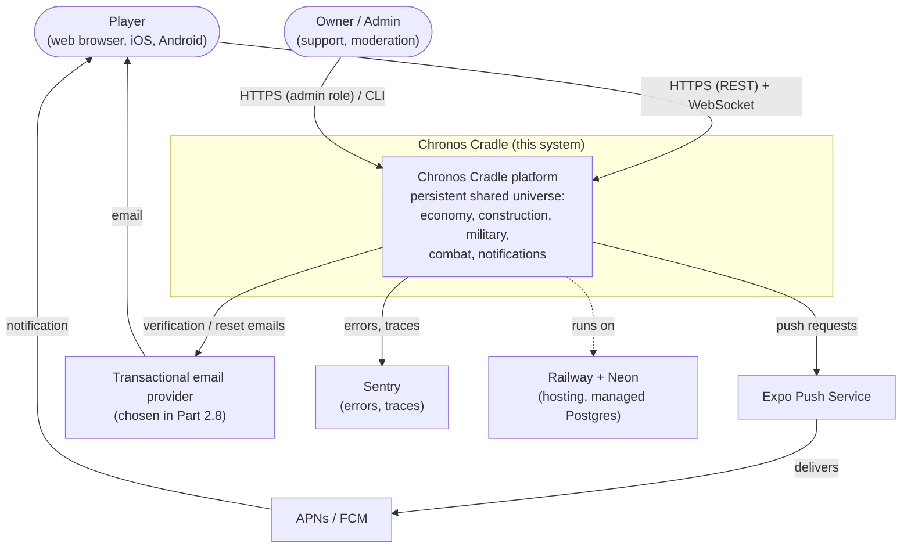

### 2.2 Level 2 — Containers

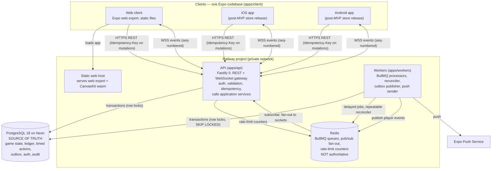

**Runtime roles** (one deployable each in the MVP; every role can scale horizontally later, see §12):

| Container | Roles | Stateless? | Correctness depends on it? |
|---|---|---|---|
| `apps/client` | UI, display-only countdowns and projections, idempotency-key generation | yes | **no** (never authoritative) |
| `apps/api` | REST, WebSocket gateway, auth (Better Auth), Zod validation, idempotency middleware, application-service calls, `GET /time` | yes (sockets are reconnectable) | yes (only path for player mutations) |
| `apps/workers` | timed-action job processor · reconciler (repeatable job) · outbox publisher · push sender · dev/admin batch tasks | yes | **no** for game state: anything it misses is caught by the reconciler, or by settlement on the next read |
| PostgreSQL | all persistent state | — | **yes** (only source of truth) |
| Redis | queues, pub/sub, rate-limit counters | — | **no**: can be flushed; the system recovers (tested in Part 3.5) |

---

## 3. Module map

### 3.1 Repository layout

The target layout follows `CLAUDE.md` §6, refined by **ADR-0011**, which adds `packages/game-core`, `packages/application` and `tools/`. Folders are created only when a Part needs them.

```
chronos-cradle/
├── apps/
│   ├── client/            Expo app (web + iOS + Android)
│   ├── api/               Fastify HTTP + WebSocket (thin)
│   └── workers/           BullMQ processors, reconciler, outbox publisher, push sender
├── packages/
│   ├── game-core/         [ADR-0011] pure primitives: integer/fixed-point math, ids, Instant/Duration types, seeded PRNG, Result
│   ├── game-data/         versioned balance data + Zod schemas + ruleset registry
│   ├── game-temporal/     Clock interface, timed-action state machine, due-action ordering
│   ├── game-economy/      accrual, modifiers, upkeep, decay, deficit/recovery, ledger rules
│   ├── game-progression/  buildings, construction, research, population rules; effect aggregation
│   ├── game-world/        coordinates, distance, world generation, spawn placement, visibility rules
│   ├── game-military/     units, recruitment, armies, formations, doctrines, movement rules
│   ├── game-combat/       deterministic Stasis/Clash/Rewind engine (pure)
│   ├── contracts/         Zod API schemas, error codes, event envelope + event catalog, wire codecs
│   ├── db/                Drizzle schema, migrations, repositories, transaction + lock helpers
│   ├── application/       [ADR-0011] use cases: lock → settle → validate → mutate → outbox → commit
│   ├── design-system/     tokens + shared UI components
│   └── config/            tsconfig, ESLint, Vitest, dependency-cruiser presets
├── tools/                 [ADR-0011] sim (4.6), worldgen CLI (7.2), admin CLI (11.6), replay (9.4)
├── infrastructure/        docker-compose (local), runbooks
└── docs/
```

### 3.2 Responsibilities and allowed imports

Each module has **one** responsibility. "May import" is exhaustive: anything not listed is forbidden and fails `depcruise` in CI (ADR-0001).

| Module | Single responsibility | May import (workspace) | Must never |
|---|---|---|---|
| `game-core` | Deterministic primitives shared by all rules | — (no workspace deps) | use I/O, `Date`, `Math.random`, floats in authoritative math |
| `game-data` | Balance data and its schemas; `ruleset_version` registry | `game-core` | contain logic beyond validation and lookup |
| `game-temporal` | What "time" means: `Clock` port, timed-action state machine, ordering | `game-core` | read a real clock |
| `game-economy` | Resource math over time | `game-core`, `game-data`, `game-temporal` | know about buildings/units (it receives modifiers) |
| `game-progression` | City development rules; converts buildings/techs/population into economy modifiers | `game-core`, `game-data`, `game-temporal`, `game-economy` | touch combat |
| `game-world` | Space: coordinates, distance, generation, spawn, visibility | `game-core`, `game-data` | know about economy |
| `game-military` | Forces and their movement rules | `game-core`, `game-data`, `game-temporal`, `game-economy`, `game-progression`, `game-world` | resolve battles |
| `game-combat` | Battle simulation from a snapshot | `game-core`, `game-data` | know about armies-as-entities, DB, time |
| `contracts` | The API and event surface | `game-core` (wire codecs), `game-data` (ids/enums) | contain rules |
| `db` | Persistence: schema, migrations, repositories, `withTransaction`, lock helpers | `game-core` (types) | contain game rules |
| `application` | Use cases and settlement orchestration; the only place that combines rules with persistence | all `game-*`, `game-data`, `db`, `contracts` (event payload types) | contain formulas (they belong in `game-*`); import Fastify/BullMQ |
| `design-system` | Visual language | — (React Native only) | import game logic |
| `config` | Shared tooling configuration | — | ship runtime code |
| `apps/api` | Transport: HTTP/WS, auth, validation, idempotency, error mapping | `application`, `contracts`, `game-data` (read-only catalog endpoints); `db` **only in the composition root** (pool creation) | contain domain logic or SQL |
| `apps/workers` | Execution of background roles | `application`, `contracts`; `db` only in the composition root | contain domain logic or SQL |
| `apps/client` | Presentation | `contracts`, `design-system`, `game-data`, `game-core`, pure `game-*` **for display projections only** (countdowns, projected balances) | import `db`/`application`; decide outcomes |
| `tools/*` | Developer/owner CLIs | as the matching app (sim: `game-*` only; admin: `application`) | ship to production clients |

Package layering (arrows = "imports"; **only direct layer edges are drawn**; the table above is the exhaustive allow-list):

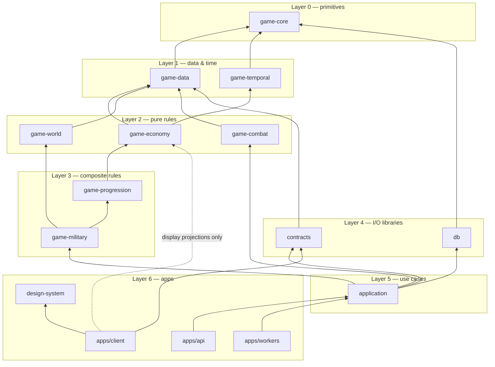

**Why `game-combat` depends only on `game-core` and `game-data`:** the engine takes a self-contained snapshot (`BattleInput`) and returns a `BattleResult`. Turning armies, doctrines and fortifications into a snapshot is the application layer's job. This keeps the engine replayable forever from stored inputs (Part 9.4), even after other packages change.

---

## 4. Core architectural patterns

### 4.1 Pure core, imperative shell
- `game-*` functions take **state + inputs + time + (seeded) randomness** as arguments and return **new state + domain events**. They never read a clock, a database or `Math.random` (lint-enforced, ADR-0002).
- The **application layer** is the shell: it loads state through `db` repositories, calls pure functions, writes results, appends ledger/audit/outbox rows, all inside one transaction.
- Injected ports: `Clock` (game-temporal), `Prng` (game-core, seeded), `JobScheduler` (implemented by workers with BullMQ; ADR-0008), `PushSender`, `Mailer`.

### 4.2 Standard write pattern (every mutating use case)

```
1. API: authenticate → Zod-validate → check Idempotency-Key (§4.6)
2. application: withTransaction(READ COMMITTED, retry on deadlock/serialization):
     a. lock the owners involved, in canonical lock order (DATABASE_DESIGN.md, 1.3)
     b. settle each locked owner up to now (§4.3)
     c. validate with pure rules (ownership, prerequisites, costs, limits)
     d. mutate: state rows + resource_ledger + timed_actions + audit_log
     e. append outbox_events (domain events + timed_action.scheduled)
     f. store idempotency response snapshot
   COMMIT
3. API: respond with the authoritative new state (the client replaces its cache)
4. After commit: outbox publisher delivers events (jobs, WS, push) — §4.4
```
A failure anywhere before COMMIT leaves **no partial state** and **no published event** (Part 3.6, 10.1).

### 4.3 Settlement model ("bring state up to now")

Time-driven state is stored as *last settled state + timestamps*. Before any read or write, the affected owners are **settled**: every due timed action is applied in deterministic order, and resources are accrued between events (Parts 3.3, 4.2).

**Settlement unit = player (empire), not city.** Research is per player and affects all of a player's cities at the same instant. Colonies (13.12) add cities. Settling per player keeps one consistent timeline across cities. In the MVP a player has one city, so the cost is the same.

**Two kinds of timed actions:**

| Kind | Examples | Touches | Resolved by |
|---|---|---|---|
| **Local** | construction, research, recruitment, own-city transfer, return-home arrival | one player | `settlePlayer(p, t)` in one transaction holding only `p`'s locks |
| **Interaction** | army arrival at another player's city or at a neutral outpost; outpost respawn affecting attackers en route | two owners (player↔player, player↔outpost) | `resolveInteraction(a)` in its own transaction, locking both owners in canonical order |

**Invariant (I-SETTLE):** *no owner is ever settled past time `t` while an interaction involving it with `completes_at ≤ t` is unresolved.*

**Algorithm (formalised in 1.3/1.4, built in 3.3 and 9.3):**
1. `settle(owner, t)` first lists unresolved due interactions involving `owner` with `completes_at ≤ t`, ordered by `(completes_at, id)`.
2. Each is resolved via `resolveInteraction(a)`. Before resolving `a`, its **other** participant is recursively brought to `a.completes_at`. That only involves strictly earlier `(completes_at, id)` keys, so recursion terminates.
3. Each step is a **short transaction** that leaves its owners at a consistent point in time (`settled_at` is monotonic). Any prefix of steps is a valid history, so a crash mid-way loses nothing; the next settle continues.
4. Finally `owner` settles its local actions and accrual up to `t`.

Lock discipline: a transaction locks **at most the owners of one step**, always in canonical order. It never acquires a lower-ordered lock while holding a higher one, so deadlocks are avoided by construction. The 2.3 retry helper remains as a safety net.

**Read optimisation (recommended, decided in 1.4/3.3):** GET endpoints persist settlement only if a **timed action is due**. Otherwise they return a *projection* computed from the last settled state (accrual is path-independent, Part 4.2), avoiding a write per read.

### 4.4 Events: synchronous calls vs. the outbox

| Need | Mechanism | Why |
|---|---|---|
| State that must change **together** (spend resources + start construction; battle losses + loot) | **Synchronous call** between application-layer modules **inside the same transaction** | Atomicity |
| Side effects that may lag: WebSocket updates, push, inbox, public stats, scheduling BullMQ jobs, analytics | **Domain event** appended to `outbox_events` in the same transaction, delivered after commit by the outbox publisher | Never publish a rolled-back event; never lose a committed one (10.1) |

Message categories (source plan X):
1. **Persistent domain events**: outbox rows with a per-player monotonic `seq`. Replayable via `GET /events?after=seq` (10.3).
2. **Ephemeral notifications**: push and toasts derived from domain events. Not replayable; the inbox (10.5) is the durable history.
3. **Client sync messages**: "invalidate query X" hints and heartbeats. Never carry authoritative state the client must trust.

The **event catalog lives in `contracts`** (Zod schema per event type). Every event type has **exactly one producing domain** (checked in Part 1.5). The names are listed in §5.

### 4.5 Time, determinism and versioning
- All time is server UTC (`timestamptz`; integer milliseconds in code). Clients call `GET /time` only to compute a **display** offset.
- Every timed action and battle stores the `ruleset_version` it was created under. Rules for an in-flight action never change retroactively; new rulesets apply to actions created after deployment (detailed in 1.4).
- Combat: input snapshot + `ruleset_version` + `seed` ⇒ identical result (rule 10). The seed is generated server-side at resolution and stored.

### 4.6 Errors, idempotency, validation
- Domain errors are typed (`InsufficientResources`, `PrerequisiteMissing`, …) and mapped by the API to the single `contracts` error format `{ code, message, details }`.
- Every mutating endpoint requires `Idempotency-Key`. Same key + same request hash ⇒ stored response. Same key + different hash ⇒ `IDEMPOTENCY_KEY_REUSED` (3.6).
- Validation happens at every boundary: HTTP body/query (Zod), WS client messages (Zod), job payloads (Zod), game-data at load (Zod), environment configuration at startup (Zod).

---

## 5. MVP domains

**`DOMAINS.md` (Part 1.5) is the authoritative 11-field definition of every domain**, and `domains-check.mjs` keeps this table consistent with it. This table is the architectural summary: where each domain lives, what it owns, and how others reach it.
**Code location rule:** each domain = pure rules in one `game-*` package + one module folder in `packages/application/src/<domain>/` + one Fastify plugin in `apps/api/src/modules/<domain>/`. Tables are listed indicatively here; `DATABASE_DESIGN.md` (1.3) is authoritative.

| # | Domain (Part) | Pure rules | Data owned (indicative) | Public interface (application layer) | Events produced | Events consumed |
|---|---|---|---|---|---|---|
| 1 | Authentication & accounts (2.8) | — (Better Auth) | `auth.*` schema (user, session, account, verification) | `getSession`, `requireAccount`, `deleteAccount` | `account.created`, `account.deleted` | — |
| 2 | Player profiles (6.1) | — (name format in `contracts`; uniqueness + profanity filter in application) | `players`, `player_profiles`, `player_stats` (read model) | `getPublicProfile`, `updateProfile` | `profile.updated`, `tutorial.step_completed` | `battle.resolved`, `outpost.cleared` (update public stats) |
| 3 | Civilizations (6.1, 7.4, 11.4) | `game-world` (protection rules) | `civilizations` (name, founded_at, protection_until, activity state) | `foundCivilization`, `isAttackable`, `endProtection` | `civilization.founded`, `protection.ended`, `civilization.activity_changed` | — (protection ends synchronously when Movement calls `endProtection`) |
| 4 | Cities (6.1, 6.6) | `game-progression` | `cities` (player_id, island_id, name) — **many per player in schema** | `getCityView`, `listCities` | `city.founded` | — |
| 5 | Buildings (6.2) | `game-progression` | `city_buildings` (city, type, level) | `getBuildings`, `setLevel` (called by Construction only) | — (Construction reports changes) | — |
| 6 | Resources / economy (4.1–4.5) | `game-economy` | `city_economy`, `resource_balances`, `resource_ledger`, `resource_deficits` | `spend`, `credit`, `transfer`, `getBreakdown`, `accrueTo` (settlement) | `resources.deficit_started`, `resources.deficit_ended`, `resources.storage_full`, `transfer.dispatched`, `transfer.arrived` (flagged) | — |
| 7 | Population (6.5) | `game-progression` | `city_population` | `reserve`, `release`, `getPopulation` | — (no shortage possible in ruleset 1, SIM §6) | — |
| 8 | Construction (6.3) | `game-progression` | construction rows in `timed_actions` (kind `construction`) | `startUpgrade`, `cancelUpgrade`, `getQueue`, `onComplete` | `construction.started`, `construction.cancelled`, `construction.completed` | — |
| 9 | Technology & research (6.4) | `game-progression` | `player_research` (completed techs) + `timed_actions` (kind `research`) | `startResearch`, `cancelResearch`, `getTree`, `onComplete` | `research.started`, `research.cancelled`, `research.completed` | — |
| 10 | Military recruitment (8.2) | `game-military` | `timed_actions` (kind `recruitment`) | `recruit`, `cancelRecruitment`, `onComplete` | `recruitment.started`, `recruitment.cancelled`, `recruitment.completed` | — |
| 11 | Armies & formations (8.3, 8.4) | `game-military` | `armies` (nullable `commander_id`), `army_units`, `garrisons`, `doctrines` | `formArmy`, `disbandArmy`, `setFormation`, `setDoctrine`, `applyLosses`, `addToGarrison` | `army.formed`, `army.disbanded`, `doctrine.changed`, `units.deserted` | — |
| 12 | Military movement (8.5) | `game-military` + `game-world` (distance) | `movements` + `timed_actions` (kind `movement`) | `dispatch`, `recall`, `onArrival` (interaction), `onReturn` (local) | `movement.dispatched`, `movement.incoming`, `movement.recalled`, `movement.arrived`, `movement.returned` | — |
| 13 | Combat simulation (S09) | `game-combat` | `battles` (input snapshot, seed, ruleset, result hash), `battle_reports` | `resolveBattle` (called by Movement.onArrival), `replay`, `getReport` | `battle.resolved` | — |
| 15 | World generation (7.2) | `game-world` | `world_generation_runs` (seed, params) | `generateRegion` (CLI/admin only) | `region.generated` | — |
| 16 | Islands (7.1, 7.3, 7.4, 7.5) | `game-world` | `regions`, `sectors`, `islands`, `outposts` (neutral state) | `queryViewport`, `placeSpawn`, `getOutpost`, `onOutpostRespawn` | `outpost.cleared`, `outpost.respawned` | — |
| 23 | Notifications & realtime (S10) | — | `outbox_events`, `player_events`, `player_event_cursors`, `event_consumptions`, `notifications`, `device_tokens`, `notification_prefs` | `publish` (outbox), `registerDevice`, `getInbox`, `whileYouWereAway` | `notification.created` (ephemeral) | all player-facing events above |
| 27 | Administration (11.3, 11.6) | — | `audit_log` (+ suspension fields via Better Auth admin plugin, 2.8/11.6) | `audit()`, `grantResources`, `suspend`, `replayBattle` | `admin.action_performed` | `battle.resolved` (fairness signals; audit itself is written synchronously) |

**Platform modules** (not among the 27 game domains, but they own data):

| Module | Lives in | Owns | Role |
|---|---|---|---|
| Simulation core (S03) | `game-temporal` + `application/settlement` | `timed_actions` (the generic table; each `kind`'s payload is defined by its domain), `player_settlement`, `ruleset_versions` | settlement, handler registry, reconciler; produces `timed_action.scheduled` |
| Idempotency (3.6) | `apps/api` middleware + `db` | `idempotency_keys` | request de-duplication |
| Fairness signals (11.5) | `application/fairness` | `fairness_signals` | detection only in MVP |

Domain 14 (temporal abilities) and domains 17–22, 24–26 are post-MVP (§13).

---

## 6. Domain dependency diagram

### 6.1 Synchronous calls (inside one transaction; arrow = "calls the interface of")

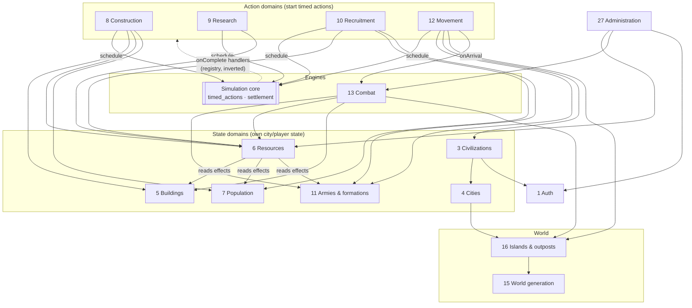

### 6.2 Event consumers (via the outbox, after commit)

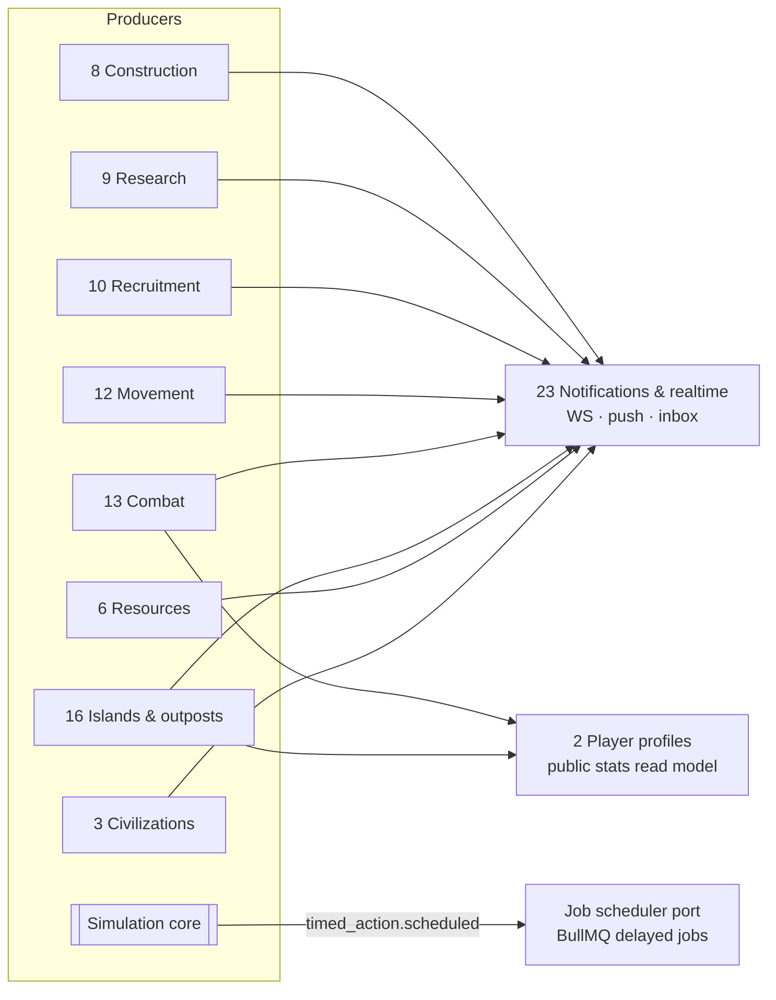

Notes:
- `resources → buildings/research/population/armies` means the economy *reads* their effects (production, capacity, upkeep) to compute rates. It does so through **read-only effect providers**, so the economy never mutates those domains.
- `sim → construction …` is the **handler registry**: the simulation core calls each kind's `onComplete` during settlement. Domains register handlers. The core does not import domain internals.
- No cycles at the **package** level: cycles in this diagram (e.g. construction ↔ sim) are broken by the registry (dependency inversion), which dependency-cruiser enforces.

---

## 7. Critical flows (sequence diagrams)

### 7.1 A player action end to end (example: start a building upgrade)

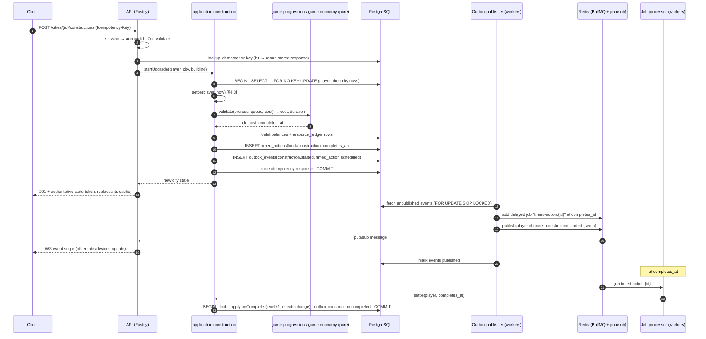

### 7.2 Timed events: scheduled job + reconciler (crash safety)

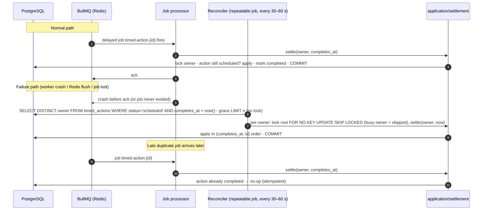

Guarantees: **at-least-once** execution of jobs, **exactly-once effect** through status checks under row lock. Lateness is bounded by `grace + reconciler interval` even with no workers running jobs. Measured as "job lag" in 12.4.

### 7.3 Spending resources under concurrency

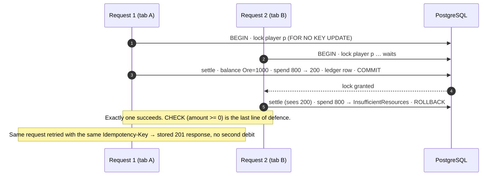

Multi-resource costs are all-or-nothing in the same transaction (4.3).

### 7.4 Army arrival → battle → report → return

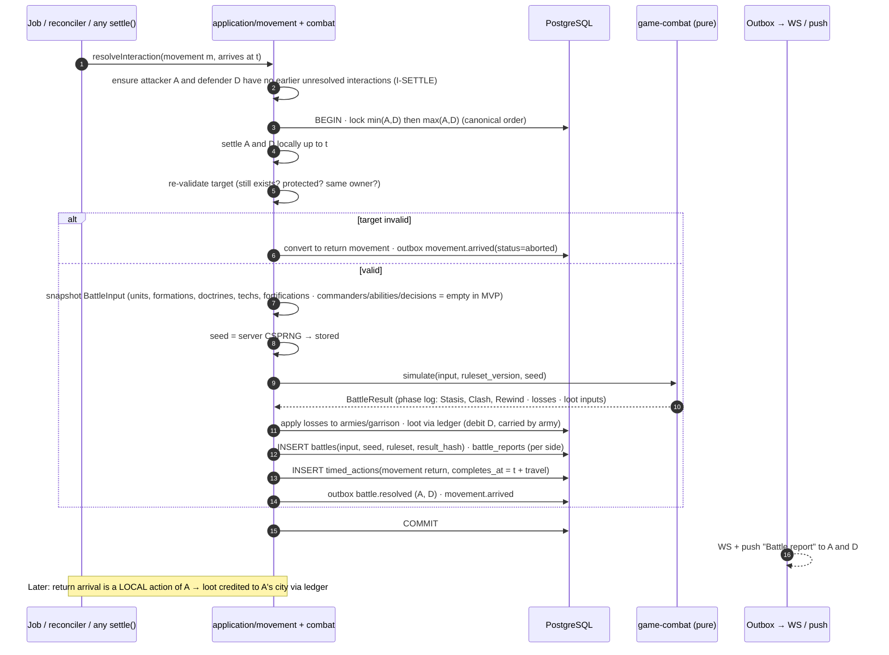

Idempotency: the `movement` action is marked completed in the same transaction that creates the battle, so a second processing is a no-op (9.3).
Neutral outposts follow the same flow, with the outpost as the second owner.

### 7.5 Reconnect and resync

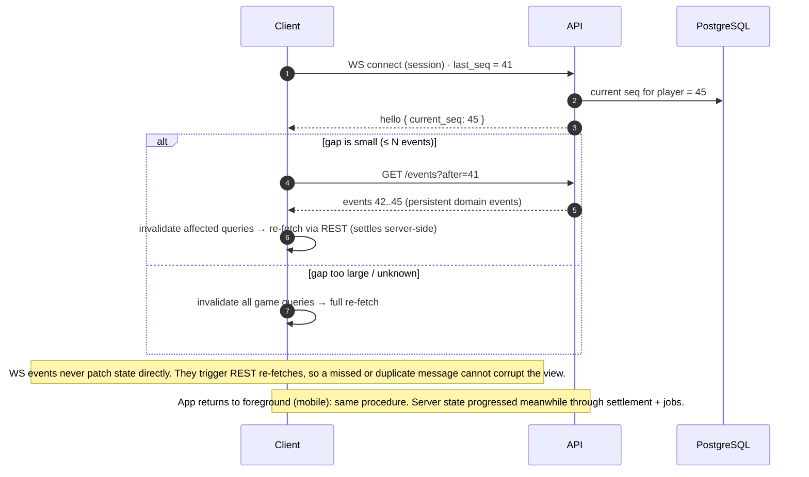

---

## 8. Gameplay flows

### 8.1 New player — first session (MVP; tutorial in 12.1)

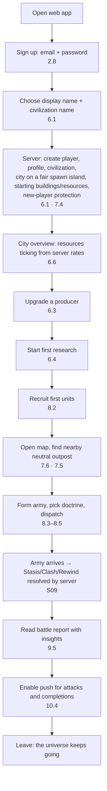

### 8.2 Core daily loop

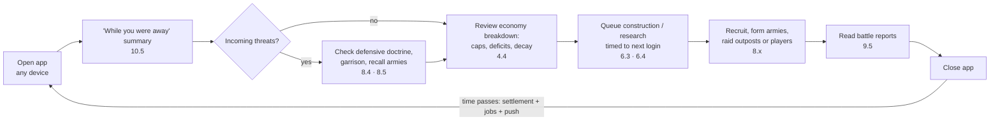

The loop rewards **planning around time** (pillar 3): queues sized to the next session, storage caps that punish waste, and travel times that make the timing of an attack a decision.

### 8.3 Army lifecycle (state machine)

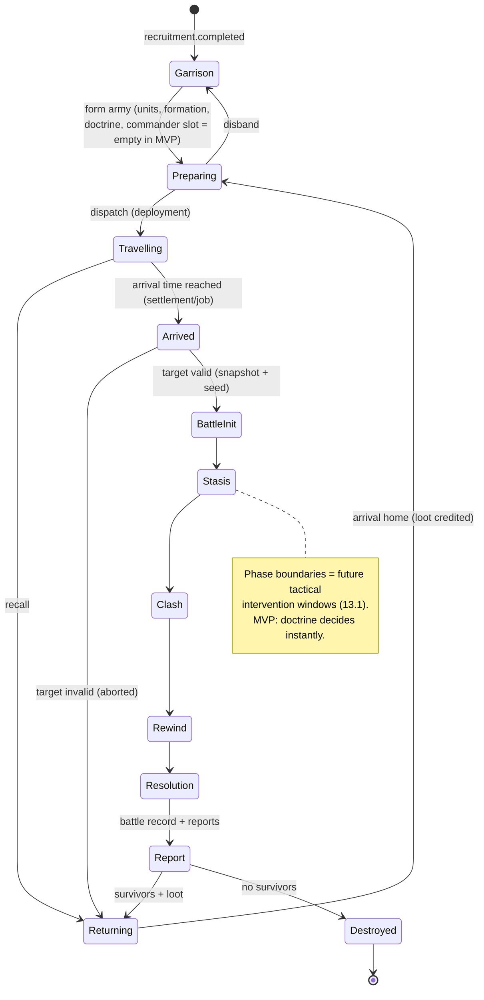

In the MVP, `BattleInit → Resolution` runs inside one transaction (instant). Post-MVP intervention windows (13.1) turn each phase boundary into a timed action with a decision window and a doctrine fallback. The states already exist, so this is an extension, not a rewrite.

---

## 9. Cross-platform architecture

| Concern | Shared (one implementation) | Platform-specific |
|---|---|---|
| API types and validation | `contracts` (Zod) — the same on web, iOS, Android and server | — |
| Balance data and display text keys | `game-data` | — |
| Rules for display projections (countdowns, projected balances) | pure `game-*` functions, fed server timestamps + `GET /time` offset | — |
| Design tokens, core components | `design-system` | small `.web.tsx` variants for hover/focus states |
| Navigation structure (routes) | Expo Router file routes | **layouts**: mobile bottom tabs, portrait-first; desktop navigation rail + multi-panel (5.3) |
| Input | — | touch gestures (mobile); mouse, trackpad, keyboard shortcuts (web) |
| Map renderer | `WorldViewModel` + camera math (pure TS in `apps/client/src/map/core`, unit-tested) | `MapCanvas.tsx` (Skia) / optional `MapCanvas.web.tsx` (PixiJS) (ADR-0004) |
| Session storage | Better Auth client | cookies (web) vs SecureStore (native) (ADR-0007) |
| Push | server-side push sender | `expo-notifications` (native); web: in-app + email fallback (decided in 10.4) |
| App lifecycle | sync rules (§7.5) | foreground/background handling (native), tab visibility (web) |
| Release | — | static web deploy (MVP); EAS builds + OTA updates (13.10) |

**One universe:** there is no platform field anywhere in game state. Accounts, cities and armies are identical whichever client created them.

---

## 10. Security architecture (overview; security risks in `RISKS.md` §5; `SECURITY.md` started in 2.8, completed in 11.1)

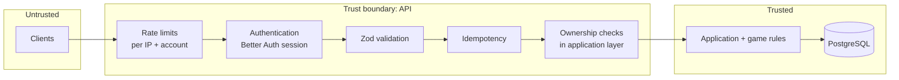

- Clients never send balances, durations, completion states, positions, battle results, cooldowns or eligibility (source plan XI). Requests carry **intents** with ids only.
- Ownership is checked in the application layer (it knows the domain model), not ad hoc in route handlers. Part 11.1 audits every endpoint.
- Admin actions use the same application layer, plus an `admin` role check and a mandatory audit row.
- Secrets live only in host environment settings; config is validated at startup; logs and Sentry events are redacted (ADR-0010).

---

## 11. Data and consistency summary

| Data | Authoritative store | Derived / cached copies | Recovery if the copy is lost |
|---|---|---|---|
| Game state, ledger, timed actions, battles | PostgreSQL | client query cache | re-fetch |
| Pending completions | `timed_actions` | BullMQ delayed jobs | reconciler re-derives (3.5) |
| Event delivery | `outbox_events` | Redis pub/sub, WS frames, push | republish unpublished rows; clients resync by `seq` |
| Rate-limit counters | Redis | — | reset is acceptable (fails open briefly) |
| Public stats, leaderboards (later) | read-model tables fed by events | — | rebuild from events/ledger |

---

## 12. Scalability path (described, not built)

The MVP runs **1 API instance, 1 worker instance, 1 Redis, 1 Postgres**. Everything is stateless except Postgres, so scaling steps are additive. Each step needs an ADR with before/after measurements (13.11). Metric sources come from 12.4.

| Step | Trigger (sustained ≥ 15 min at peak unless noted) | What changes | Already prepared by |
|---|---|---|---|
| S1 — 2+ API instances | API CPU > 70% or p95 latency > 300 ms, with DB healthy | add instances behind the platform load balancer | stateless API; WS fan-out via Redis pub/sub (10.2) |
| S2 — Split worker roles | job lag p95 > 10 s, or outbox backlog > 1,000 rows | separate deployments per queue/role (timed actions, outbox, push) | roles are separate BullMQ queues from day one |
| S3 — Hot-read caching | map/profile reads > 60% of DB time | cache static terrain and public profiles in Redis with event-driven invalidation | map static data separated from dynamic occupancy (7.3) |
| S4 — Read replica | primary CPU > 70% from read-only traffic | route map/report/history reads to a Neon read replica (replica lag acceptable for those views) | read-only repositories marked in `db` |
| S5 — Region sharding | one region exceeds its player capacity target (set in 12.7) or settlement lock contention grows | open new regions; **region-sharded worker queues** (`timed-actions:{region}`) | `region_id` on all world-scoped rows; regions → sectors → islands (1.3) |
| S6 — Separate realtime gateway | > ~5,000 concurrent sockets per API instance, or deploys disrupting sockets measurably | move the WS gateway to its own service subscribing to Redis | WS is already a separate Fastify plugin with no game logic |
| S7 — Extract a service | one module's load or release cadence diverges (e.g. combat simulation CPU) | extract behind the same application interface; communicate via outbox events | package boundaries + outbox |
| S8 — Partition big tables | `resource_ledger` / `outbox_events` / `battles` > ~50M rows or vacuum issues | time-based partitioning, archival of published outbox rows | append-only design; time columns indexed |

Explicitly **not** planned without measurements: microservices, Kubernetes, multi-region active-active, event sourcing for all state.

---

## 13. Post-MVP domains: where they plug in

Every post-MVP feature extends an MVP seam instead of rewriting it. Data-model hooks are designed in 1.3; formulas are outlined in 1.4.

| Post-MVP domain (Part) | Package / module | Plugs into (MVP seam) | New data (attaches to) | New events |
|---|---|---|---|---|
| Colonization & territorial expansion (13.12) | `game-world` + `game-military` + `application/colonization` | many cities per player (6.1); per-player settlement over all cities (§4.3); resource transfers (4.5, flag on); combat result type `capture` | `territories` (→ islands/sectors), colony founding as `timed_actions` kind `colonization` | `colony.founded`, `territory.captured` |
| Commanders (13.13) | `game-military` + `game-combat` input | nullable `armies.commander_id` (8.3); `BattleInput.commanders` (9.1) | `commanders` (→ players) | `commander.recruited`, `commander.injured` |
| Strategic infrastructure (13.14) | `game-world` + `game-economy`/`game-military` modifiers | modifier pipeline (economy), movement-duration modifiers (8.5), interaction settlement (§4.3) | `world_structures` (→ islands/territories) | `structure.built`, `structure.destroyed` |
| Tactical intervention windows (13.1) | `game-combat` phase boundaries + `application/combat` | explicit phase boundaries (9.2); doctrines as fallback (8.4); `BattleInput.decisions` | `battle_decision_windows`, `battle_decisions` (→ battles) | `battle.window_opened`, `battle.decision_made` |
| Temporal abilities (13.2) | new `game-temporal-abilities` module inside `game-military`/`game-combat` | `BattleInput.abilities` (9.1); timed-action modifiers (3.2) | `ability_cooldowns` (→ players) | `ability.activated` |
| Exploration (13.3) | `game-world` | timed actions (kind `expedition`), visibility rules (7.3) | `discoveries`, `anomalies` (→ sectors) | `exploration.discovered` |
| Trading & market (13.4) | `game-economy` + `application/market` | ledger `transfer` (4.3/4.5), outbox | `market_orders`, `trades` (→ cities, ledger) | `trade.executed` |
| Alliances (13.5) | `application/alliances` | notifications fan-out by recipient list (10.1); visibility rules | `alliances`, `alliance_members` (→ players) | `alliance.member_joined` |
| Diplomacy (13.6) | `application/diplomacy` | attack validation hook in Movement.dispatch / arrival re-validation | `treaties` (→ players/alliances) | `treaty.signed`, `treaty.broken` |
| Temporal corruption (13.7) | `game-economy` modifier + `game-world` | modifier pipeline with exact start/end timestamps | `corruption_levels` (→ cities/sectors) | `corruption.threshold_crossed` |
| World & seasonal events (13.15) | `game-world` + modifiers | world/region-scoped timed actions; modifiers with timestamps inside accrual | `world_events` (→ regions) | `world_event.started`, `world_event.ended` |
| Great Convergence (13.8) | `application/seasons` | world events + rankings read models; ruleset versioning | `seasons`, `season_rankings`, `historical_records` (→ players) | `season.started`, `season.ended` |
| Monetization (13.9, owner decision) | `application/store` | server-side receipt validation; ledger for any granted items | `purchases`, `entitlements` (→ accounts) | `purchase.completed` |
| Chat moderation (27, post-MVP part) | `application/moderation` | audit log, admin role | `reports`, `moderation_actions` | `moderation.action_taken` |
| Mobile store release (13.10) | `apps/client` | same codebase (ADR-0003) | `device_tokens` already exist (10.4) | — |
| Scaling (13.11) | infrastructure | §12 | — | — |

---

## 14. Feature locator (A–Z)

| Feature | Rules (pure) | Orchestration | Transport | Data (1.3) | Client | Part |
|---|---|---|---|---|---|---|
| Account sign-up/in, deletion | — | Better Auth + `application/accounts` | `api/modules/auth` | `auth.*` | `app/(auth)/*` | 2.8 |
| Admin tools | — | `application/admin` | `api/modules/admin`, `tools/admin` | `audit_log` | admin screens | 11.6 |
| Alliances | — | `application/alliances` | `api/modules/alliances` | `alliances*` | — | 13.5 |
| Armies, formations | `game-military` | `application/armies` | `api/modules/armies` | `armies`, `army_units` | military screens | 8.3 |
| Audit log | — | `application/admin.audit()` | — | `audit_log` | — | 11.3 |
| Battle reports | `game-combat` (insights from log) | `application/combat` | `api/modules/reports` | `battle_reports` | reports inbox | 9.5 |
| Battle replay | `game-combat` | `application/combat.replay` | `tools/replay` | `battles` | — | 9.4 |
| Buildings, effects | `game-progression` | `application/buildings` | `api/modules/cities` | `city_buildings` | city screens | 6.2 |
| City founding | `game-world` (spawn), `game-progression` (start state) | `application/onboarding` | `api/modules/onboarding` | `players`, `civilizations`, `cities` | onboarding | 6.1, 7.4 |
| Clock / server time | `game-temporal` | — | `GET /time` | — | time-offset service | 3.1 |
| Colonization | `game-world`, `game-military` | `application/colonization` | — | `territories` | city switcher | 13.12 |
| Combat engine | `game-combat` | `application/combat` | — | `battles` | — | 9.1–9.3 |
| Commanders | `game-military`, `game-combat` | `application/commanders` | — | `commanders` | — | 13.13 |
| Construction queue | `game-progression` | `application/construction` | `api/modules/construction` | `timed_actions` | queue UI | 6.3 |
| Design system | — | — | — | — | `packages/design-system` | 5.1–5.2 |
| Doctrines | `game-military` | `application/armies` | `api/modules/armies` | `doctrines` | army screen | 8.4 |
| Economy breakdown | `game-economy`, `game-progression` | `application/resources` | `api/modules/resources` | `resource_balances` | breakdown screen | 4.4, 6.6 |
| Economy simulation | all `game-*` | — | `tools/sim` | — | — | 4.6 |
| Error format / codes | — | domain errors | `contracts` | — | API client | 2.4 |
| Event catalog | — | — | `contracts/events` | `outbox_events` | sync layer | 10.1 |
| Exploration | `game-world` | `application/exploration` | — | `discoveries` | — | 13.3 |
| Great Convergence | — | `application/seasons` | — | `seasons` | — | 13.8 |
| Idempotency | — | — | `api` middleware | `idempotency_keys` | key generation (5.4) | 3.6 |
| Inactive players, fairness | `game-world`/`game-military` rules | `application/fairness` | — | `civilizations` state | help text | 11.4 |
| Localization | — | — | — | — | i18n files | 12.2 |
| Map queries | `game-world` (visibility) | `application/world` | `api/modules/map` | `islands`, `regions` | — | 7.3 |
| Map rendering | `apps/client/src/map/core` | — | — | — | `MapCanvas` | 7.6 |
| Market / trading | `game-economy` | `application/market` | — | `market_orders` | — | 13.4 |
| Monetization | — | `application/store` | — | `purchases` | — | 13.9 |
| Movement | `game-military`, `game-world` | `application/movement` | `api/modules/movements` | `movements`, `timed_actions` | dispatch flow | 8.5 |
| Multi-account signals | — | `application/fairness` | admin report | `fairness_signals` | — | 11.5 |
| New-player protection | `game-world` | `application/civilizations` | — | `civilizations.protection_until` | map badge | 7.4 |
| Notifications inbox | — | `application/notifications` | `api/modules/notifications` | `notifications` | inbox | 10.5 |
| Observability | — | — | pino, Sentry | — | Sentry RN | 12.4 |
| Outbox / publisher | — | `application/outbox` | `workers` | `outbox_events` | — | 3.4*, 10.1 |
| Outposts (PvE) | `game-world`, `game-combat` | `application/world` | `api/modules/map` | `outposts` | map | 7.5 |
| Population | `game-progression` | `application/population` | `api/modules/cities` | `city_population` | city screens | 6.5 |
| Push notifications | — | `application/notifications` | `workers` push sender | `device_tokens`, `notification_prefs` | `expo-notifications` | 10.4 |
| Rate limiting | — | — | `@fastify/rate-limit` + Redis | — | error UI | 11.2 |
| Realtime (WebSocket) | — | — | `api/realtime` plugin | `player_events`, `player_event_cursors` | sync layer | 10.2–10.3 |
| Reconciler | `game-temporal` | `application/settlement` | `workers` | `timed_actions` | — | 3.5 |
| Recruitment | `game-military` | `application/recruitment` | `api/modules/recruitment` | `timed_actions` | barracks screen | 8.2 |
| Research | `game-progression` | `application/research` | `api/modules/research` | `player_research` | research screen | 6.4 |
| Resource ledger, spend/credit | `game-economy` | `application/resources` | — | `resource_ledger` | — | 4.3 |
| Resource transfers | `game-economy` | `application/resources.transfer` | flagged off | `timed_actions` | — | 4.5 |
| Settlement | `game-temporal`, `game-economy` | `application/settlement` | every read/write | `timed_actions`, balances | — | 3.3 |
| Strategic infrastructure | `game-world` | `application/infrastructure` | — | `world_structures` | — | 13.14 |
| Temporal abilities | `game-military`/`game-combat` | `application/abilities` | — | `ability_cooldowns` | — | 13.2 |
| Temporal corruption | `game-economy` | — | — | `corruption_levels` | — | 13.7 |
| Treaties / diplomacy | — | `application/diplomacy` | — | `treaties` | — | 13.6 |
| Tutorial / onboarding | `game-data` objectives | `application/tutorial` | `api/modules/tutorial` | `tutorial_progress` | tutorial UI | 12.1 |
| World events | `game-world` | `application/world-events` | — | `world_events` | — | 13.15 |
| World generation | `game-world` | `application/world` | `tools/worldgen` | `regions`, `sectors`, `islands` | debug view | 7.2 |

\* See §15, item 1.

---

## 15. Open points and directive interactions found in this Part

1. **Build order: outbox before 10.1.** Part 3.4 enqueues jobs "via outbox", but the outbox table and publisher are specified in Part 10.1. **Proposal:** Part 3.4 creates a minimal `outbox_events` table and publisher that handles `timed_action.scheduled` only. Part 10.1 extends it with recipients, per-player `seq`, Redis pub/sub and the full catalog. To be confirmed in 1.6 when PROGRESS is updated.
2. **Settlement across players.** Part 3.3 describes settling one owner in one transaction. §4.3 refines this for interactions (battles, outposts) without contradicting 3.3 or 9.3: local settlement stays one transaction, and interactions are resolved first in their own transactions. 1.3 (lock order) and 1.4 (ordering rules) formalise it.
3. **Read path writes.** It is recommended (§4.3) that reads persist only when actions are due and otherwise project. Final decision in 1.4/3.3.
4. **Owner of new-player protection.** Assigned to *Civilizations* (the player's in-world status). Part 7.4 builds it. Confirm in 1.5.
5. **Outposts' domain.** Assigned to *Islands & territories* (world entities), with combat via the normal interaction flow. Confirm in 1.5.
6. **Map view-model location** (open in ADR-0004): resolved here as `apps/client/src/map/core` (pure TS, client-only). ADR-0004 updated.
